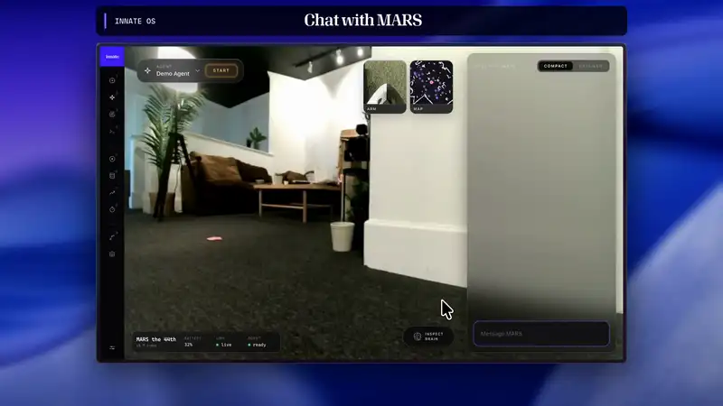
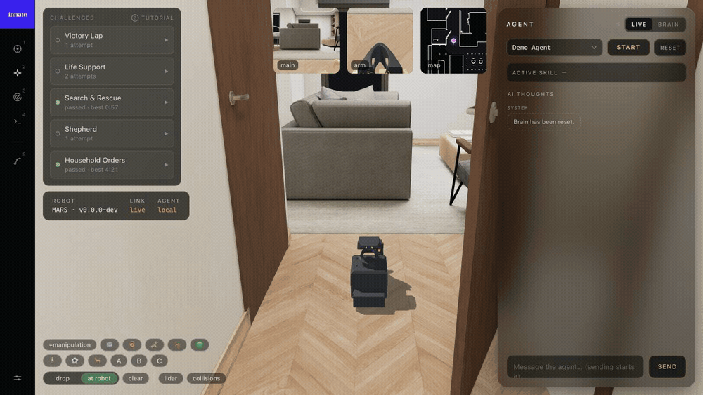

<!-- markdownlint-disable MD033 MD046 -->
<div align="center">

<picture>
  <source media="(prefers-color-scheme: dark)" srcset="docs/assets/readme/innate-os-repo-intro-dark.png">
  <source media="(prefers-color-scheme: light)" srcset="docs/assets/readme/innate-os-repo-intro.png">
  
</picture>

**The open-source runtime for autonomous physical agents.**


Build autonomous robots from reusable skills, continuous perception, spatial memory, and learned policies. Run your agents in simulation, then on physical hardware.

[](https://sim.innate.bot)

**No robot required to get started.**

[Documentation](https://docs.innate.bot) · [Discord](https://discord.gg/innate) · [Website](https://innate.bot)

</div>

## What you can build

<table>
  <tr>
    <th align="center">Agentic task execution</th>
    <th align="center">Spatial memory</th>
  </tr>
  <tr>
    <td align="left">Combine navigation, pick-up, and put-away skills around a goal. The agent observes while skills run and can interrupt them as the world changes. <a href="workspace/innate_agents/demo_agent.py">See the demo agent →</a></td>
    <td align="left">Ask about a place or object the robot has seen. Search remembered views for an image, map coordinates, and when it was seen, then navigate to the match. <a href="workspace/innate_skills/search_memory.py">See memory search →</a></td>
  </tr>
  <tr>
    <th align="center">Learned manipulation</th>
    <th align="center">Simulation → hardware</th>
  </tr>
  <tr>
    <td align="left">Record demonstrations, train a LeRobot policy, and deploy it as a skill alongside Python code and recorded motions. <a href="https://docs.innate.bot/training/overview">Explore training →</a></td>
    <td align="left">Build with the same agents, skills, and web app in the simulator and on MARS. Simulated hardware replaces physical drivers. <a href="https://docs.innate.bot/simulator/building-with-the-simulator">Build in simulation →</a></td>
  </tr>
</table>

## See it in action

<table>
  <tr>
    <td width="50%"><a href="https://docs.innate.bot/software/skills"></a></td>
    <td width="50%"></td>
  </tr>
  <tr>
    <td><strong>Move a chess piece. Open a door.</strong><br>Reusable skills on a real MARS.</td>
    <td><strong>Find and pick up a sock.</strong><br>Give MARS a goal through the web app.</td>
  </tr>
</table>

MARS is the supported reference hardware today. Innate OS separates agents, skills, and inputs from the robot drivers; ports to other robots are welcome and require hardware integration. [MARS quick start →](https://docs.innate.bot/get-started/mars-quick-start)

## Try it without a robot

<p align="center">
  <a href="https://sim.innate.bot"></a>
</p>

**[Try the simulator →](https://sim.innate.bot)** — no install, no robot.

Or clone and run it locally on macOS, Linux, or WSL2. This installer clones the repository and sets up the simulator:

```bash
curl -fsSL https://link.innate.bot/sim | sh
cd innate-os
./innate-sim up
```

Open [https://localhost](https://localhost) to drive, run skills, and talk to the agent. [Simulator setup →](https://docs.innate.bot/simulator/setup)

## Skills

Skills are the unit of action on an Innate robot — a software call, a motion, or a learned policy.

<p align="center">
  
</p>

Run them from the [web app](https://docs.innate.bot/robots/web-app), the [phone app](https://docs.innate.bot/robots/innate-controller-app), or an agent. Write your own in `workspace/custom_skills/` — the [workspace guide](workspace/README.md) is the hello world.

<table>
  <tr>
    <th width="50%">A skill that nods</th>
    <th width="50%">A skill that searches memory</th>
  </tr>
  <tr>
    <td valign="top">

```python
from innate import Head, Skill

class Nod(Skill):
    """Give a small nod."""
    head: Head

    def execute(self):
        self.head.set_position(10)
        self.sleep(0.4)
        self.head.set_position(0)
        return "Nodded"
```

</td>
    <td valign="top">

```python
from innate import Skill, SkillOutput, SpatialMemory

class SearchMemory(Skill):
    """Find a remembered place or object on the current map."""
    memory: SpatialMemory

    def execute(self, query: str):
        recall = self.memory.begin(query)
        verdict = self.wait_for(recall, timeout=150.0)
        if verdict is None:
            self.fail("memory search timed out")
        if verdict.error:
            self.fail(verdict.message)
        return SkillOutput(verdict.message, image=verdict.image)
```

</td>
  </tr>
  <tr>
    <td>Uses the head control from <a href="workspace/innate_skills/head_emotion.py">HeadEmotion</a>.</td>
    <td>Condensed from <a href="workspace/innate_skills/search_memory.py">SearchMemory</a>, including timeout and error handling.</td>
  </tr>
</table>

Built-in skills live in `workspace/innate_skills/`. You can also [record a motion and train a policy](https://docs.innate.bot/training/overview), then deploy it as a skill.

**[Skills documentation →](https://docs.innate.bot/software/skills)**

## Agents

Agents let the robot act on its own. One combines a set of skills, a prompt, inputs, and a loop that turns observations into actions.

<p align="center">
  
</p>

### Example: An agent that finds a remembered place

Short pseudocode showing the composition; the expanded example below uses the full Python API.

```python
# Pseudocode: compose skills, an input, and instructions.
agent = Agent(
    skills=[SearchMemory, NavigateToPosition],
    inputs=[MicroInput],
    prompt="Search memory for the requested place. "
           "Navigate to its map coordinates with local_frame=false. "
           "If nothing matches, ask for help. Stop when asked.",
)
```

For a fuller example matching the video, add turning, pick-up, and drop-off:

“Put the socks in the low box.” Combine memory, navigation, turning, pick-up, and drop-off skills.

<details>
<summary><strong>Read the sock-cleanup agent</strong> — <em>click to expand</em></summary>

```python
from innate import Agent, InputRef, SkillRef
from innate_skills.drop_in_box import DropInBox
from innate_skills.navigate_to_position import NavigateToPosition
from innate_skills.pick_any_object import PickAnyObject
from innate_skills.search_memory import SearchMemory
from innate_skills.turn_in_place import TurnInPlace
from inputs.micro_input import MicroInput


class SockCleanupAgent(Agent):
    @property
    def id(self) -> str:
        return "sock_cleanup_agent"

    @property
    def display_name(self) -> str:
        return "Sock cleanup"

    def get_skills(self) -> list[SkillRef]:
        return [SearchMemory, NavigateToPosition, TurnInPlace,
                PickAnyObject, DropInBox]

    def get_inputs(self) -> list[InputRef]:
        return [MicroInput]

    def get_prompt(self) -> str:
        return """Put socks into the low box the user identifies, one at a time.
Search memory for socks or the box when out of view. Navigate to remembered
map coordinates with local_frame=false, then confirm the target on camera.
Turn in small steps to look around only when there is clearance to rotate.
PickAnyObject(prompt="the sock") picks up a visible sock. After a successful
pick-up, find the box and call DropInBox(prompt="the low box") only when it
is visible and within arm reach. Confirm the sock landed inside, then repeat.
If a target is missing, an action fails, or the result is unclear, ask for help.
Stop immediately when asked; do not retry. Report when no more socks are found.
"""
```

Save as `workspace/custom_agents/sock_cleanup_agent.py` and select **Sock cleanup** in the web app. Memory needs recorded views on the current map; use a low container the arm can reach over.

</details>

Because the robot lives in the physical world, agents observe continuously and can interrupt a running skill when the world changes.

**[Agents documentation →](https://docs.innate.bot/software/agents)**

## Inputs

Stream new data into a running agent — a custom sensor, a webhook, an API. Devices live in `workspace/inputs/` and are requested by class.

### Example: An input that reports an arm fault

Simplified pseudocode: `subscribe` and `unsubscribe` stand in for ROS subscription setup and cleanup.

```python
# Pseudocode adapted from ArmVitalsInput.
class ArmVitalsInput(InputDevice):
    name = "arm_vitals"

    def on_open(self):
        self.was_ok = True
        self.subscription = subscribe("/mars/arm/status", self.on_status)

    def on_status(self, status):
        if not self.is_active():
            return
        if self.was_ok and not status.is_ok:
            self.send_data(f"Arm servo failed: {status.error}",
                           data_type="chat_in")
        self.was_ok = status.is_ok

    def on_close(self):
        unsubscribe(self.subscription)
```

Based on [ArmVitalsInput](workspace/inputs/arm_vitals_input.py). It reports each transition into failure once, rather than repeating the alert on every status update. Add `ArmVitalsInput` to your agent's `get_inputs()` list to use the real implementation.

**[Input devices →](https://docs.innate.bot/software/inputs)**

## Train with Innate

Record demonstrations in the phone or web app, train an ACT policy on Innate’s GPUs, and deploy it as a skill your agents can call. No local GPU setup required.

**[Record → train → deploy](https://docs.innate.bot/training/overview)**

## LeRobot

MARS is a [LeRobot](https://github.com/huggingface/lerobot) robot. Record datasets while you teleoperate from the phone app or the web app, train any LeRobot policy on them, and run it back on the robot, with the standard commands and `--robot.type=mars`:

```bash
cd lerobot && uv sync
export MARS_HOST=192.168.1.42    # your robot's IP address
uv run hf auth login             # datasets upload to your Hugging Face account

uv run lerobot-record --robot.type=mars --robot.external_commands=true \
    --teleop.type=mars_passthrough --dataset.repo_id=YOUR_HF_NAME/mars-tidy-up \
    --dataset.single_task="Put the ball in the box" --dataset.num_episodes=10 \
    --dataset.private=true
```

You can also record in the web app or the phone app: the web app's Datasets page has a **Publish to Hugging Face** button that converts a recording to the same LeRobotDataset format.

**[MARS on LeRobot →](lerobot/README.md)**

## Documentation

This README is an introduction. The rest lives in the docs:

- [Building with the simulator](https://docs.innate.bot/simulator/building-with-the-simulator)
- [Workspace guide](workspace/README.md)
- [Getting started](https://docs.innate.bot/get-started/mars-quick-start)
- [Simulator](https://docs.innate.bot/simulator)
- [Skills](https://docs.innate.bot/software/skills)
- [Agents](https://docs.innate.bot/software/agents)
- [Input devices](https://docs.innate.bot/software/inputs)
- [Training](https://docs.innate.bot/training/overview)
- [MARS on LeRobot](lerobot/README.md)
- [Web app](https://docs.innate.bot/robots/web-app) and [controller app](https://docs.innate.bot/robots/innate-controller-app)
- [CLI](https://docs.innate.bot/software/innate-cli)
- [ROS 2 core and system overview](https://docs.innate.bot/software/ros2-core)

Most builders should start with skills, agents, inputs, and the simulator. Changing the ROS core is possible; it is not the usual path.

## License

Innate OS is open source under [Apache 2.0](LICENSE). Third-party code we ship is credited in [`NOTICE`](NOTICE).

The simulator's environments and characters are a separate matter: several are third-party works under CC BY 4.0, fetched at build time rather than stored here. They carry their own terms, listed per asset in [`sim/ATTRIBUTION.md`](sim/ATTRIBUTION.md).

## Contributing

We welcome contributions, apps built on Innate OS, and ports to other robots — we will be happy to feature them.

**[Contributing guide](.github/CONTRIBUTING.md)** · **[Discord](https://discord.gg/innate)**
